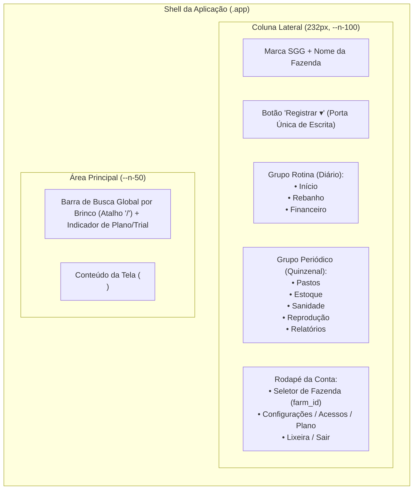
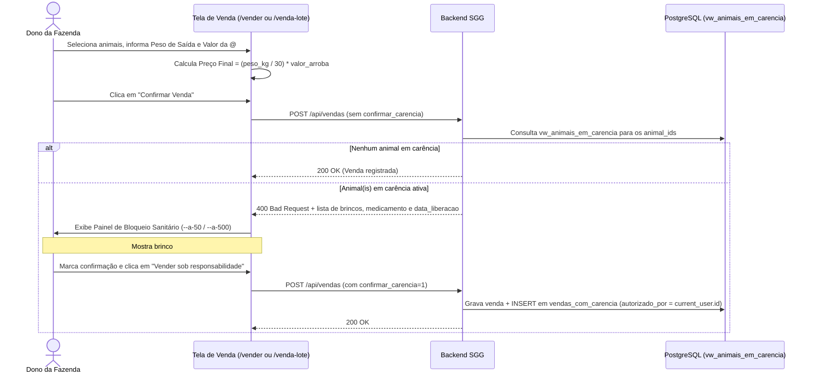
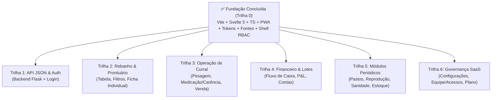

# Guia de Arquitetura Visual e Desenho de Telas — SGG (Sistema de Gestão de Gado)

> **Escopo deste documento:** Especificação completa de Design System, padrões de interação, ergonomia de campo e desenho de telas para o novo frontend do **SGG**, alinhada à sua identidade original (*Instrumento de Medição Zootécnica*) e ao motor de regras já presente no backend (`repositories/`, `services/`, `utils/permissions.py`, `utils/carencia.py` e `utils/plano.py`).

---

## 1. Direção de Arte e Conceito: "Field Ledger & Scale Readout" (Caderno de Campo e Visor de Tronco)

O novo SGG abandona tanto o visual chapado/clínico anterior quanto os clichês genéricos de SaaS IA (fundos creme/areia, gradientes decorativos, vidro fosco e emojis) em favor de uma estética **Field Ledger & Scale Readout** (*Caderno de Campo e Visor de Tronco*):

### 1.1 Os 4 Pilares Visuais
1. **Superfícies Minerais de Alto Contraste Sob o Sol (`#F2F4F1` + `#FFFFFF`):**
   Fundo geral em pedra mineral fria (`#F2F4F1` / `oklch(0.965 0.004 145)`) com superfícies de leitura em branco puro (`#FFFFFF`), separadas por bordas estruturais nítidas de `1px` (`#DCE1DA`) e raios contidos (`6px` a `8px`) sem sombras difusas ou levitação no hover.
2. **Assinatura Visual Única: Visores Contínuos (`.metric-strip` / `.metric-cell`):**
   KPIs nunca aparecem como grades de cartões flutuantes soltos. Toda tela operacional abre com uma **faixa de medição contínua** (`.metric-strip`) dividida por fios verticais de `1px` (`#DCE1DA`), com rótulo em caixa de sentença, valor tabular em `IBM Plex Mono` (`tabular-nums`) e unidade explícita (`kg/d`, `@`, `UA/ha`, `R$`).
3. **Semântica Zootécnica Estrita e Zero Ornamentação:**
   - **Verde-Pastagem (`#155E3B`):** Ação primária, traço principal e GMD dentro da meta.
   - **Ocre Manejo (`#9A5B13`):** Alertas operacionais, proximidade de parto e estoque em ponto de reposição.
   - **Óxido Sanitário (`#B42318`):** Bloqueio de venda por carência sanitária (`vw_animais_em_carencia`), GMD crítico e contas vencidas.
   - **Proibições absolutas:** Zero emojis como ícones de interface (apenas ícones vetoriais SVG `1.75px`), zero `backdrop-filter: blur()`, zero gradientes decorativos e zero `UPPERCASE` em rótulos.
4. **Ergonomia Dupla (Escritório Denso + Tronco de Contenção Mobile):**
   - **Desktop:** Sidebar estrutural clara (`248px` ↔ `64px`) em `#FFFFFF` com indicador ativo de `3px` e TopBar com busca global por brinco (`/`) e fita de cotação em linha.
   - **Mobile:** Barra inferior (`BottomNav.svelte`) + *Action Sheet* acessível para operação com uma mão e alvos de toque de `48px–56px` nas telas de curral.

---

## 2. Tokens do Design System

### 2.1 Paleta de Cores (CSS Custom Properties)

| Token | Hex / OKLCH | Função e Regra de Uso |
| :--- | :--- | :--- |
| `--n-0` (`--color-surface`) | `#FFFFFF` (`oklch(1 0 0)`) | Superfície de tabelas, faixas `.metric-strip`, sidebar e inputs |
| `--n-25` (`--color-surface-raised`) | `#F8FAF7` (`oklch(0.982 0.003 145)`) | Cabeçalhos de tabela, células de subtotais e hover de linha |
| `--n-50` (`--color-surface-sunken`) | `#F2F4F1` (`oklch(0.965 0.004 145)`) | Fundo mineral geral da página (`<body>`) |
| `--n-200` (`--color-border`) | `#DCE1DA` (`oklch(0.905 0.007 145)`) | Fio divisório estrutural de `1px` entre painéis e células |
| `--n-350` (`--color-border-strong`) | `#94A098` | Borda de inputs e controles interativos (contraste `> 3:1` no branco) |
| `--n-500` (`--color-ink-tertiary`) | `#525E56` (`oklch(0.47 0.015 150)`) | Rótulos secundários e unidades (`kg/d`, `@`, `UA/ha`) — contraste WCAG AA `6.4:1` |
| `--n-600` (`--color-ink-secondary`) | `#3B453E` (`oklch(0.38 0.015 150)`) | Texto de apoio, subtítulos e itens de navegação |
| `--n-900` (`--color-ink`) | `#111814` (`oklch(0.20 0.015 150)`) | Tinta principal de texto, títulos e números neutros |
| `--g-50` (`--color-primary-bg`) | `#E6F2EC` | Fundo de badge positivo (GMD na meta, liberado, pago) |
| `--g-500` (`--color-primary`) | `#155E3B` (`oklch(0.43 0.095 155)`) | Ação primária, traço principal de gráficos, GMD dentro da meta |
| `--g-700` (`--color-primary-dark`) | `#0E4429` | Hover/Active de botões primários |
| `--w-50` (`--color-warn-bg`) | `#FDF3E7` | Fundo de alerta operacional moderado |
| `--w-500` (`--color-warn`) | `#9A5B13` (`oklch(0.52 0.11 65)`) | Ocre de manejo: estoque baixo, revisão de lote, parto próximo |
| `--a-50` (`--color-danger-bg`) | `#FCEAE8` | Fundo de bloqueio de carência sanitária e linha crítica |
| `--a-500` (`--color-danger`) | `#B42318` (`oklch(0.48 0.17 28)`) | Óxido: trava de carência sanitária, GMD crítico, vencido |
| `--a-700` (`--color-danger-dark`) | `#8A1A11` | Hover de ação destrutiva e texto de ênfase sobre `--a-50` |

### 2.2 Tipografia e Regras de Escrita

- **Família de Interface e Títulos (`--font-display`, `--font-body`):** `'Archivo', system-ui, sans-serif` (Self-hosted `.woff2`).
- **Família de Dados e Números (`--font-dado`):** `'IBM Plex Mono', ui-monospace, monospace` com `font-feature-settings: 'tnum' 1`.
- **Escala Tipográfica Densa:**
  - `--text-3xl` (`2.125rem` / `34px`): Mostrador principal de KPI (ex.: GMD médio do rebanho, Saldo Anual).
  - `--text-2xl` (`1.625rem` / `26px`): Título da página (`.page-title`, `tracking: -0.02em`).
  - `--text-xl` (`1.375rem` / `22px`): Título de seção (`.section-title`).
  - `--text-lg` (`1.125rem` / `18px`): Cabeçalho de cartão ou modal.
  - `--text-base` (`0.875rem` / `14px`): Corpo padrão da aplicação e células de tabela.
  - `--text-sm` (`0.8125rem` / `13px`): Rótulos de campo (`.label`), subtítulos e metadados.
  - `--text-xs` (`0.75rem` / `12px`): Badges, atalhos de teclado (`<kbd>/</kbd>`) e notas de rodapé.
- **Proibição de CAIXA ALTA em Rótulos:**
  Rótulos de formulário, cabeçalhos de tabela e grupos de menu usam **Caixa de Sentença** (*"Peso atual (kg)"*, *"GMD médio"*, *"Data da compra"*). Caixa alta com espaçamento aberto reduz a velocidade de leitura e é reservada apenas a siglas reais do domínio (`GMD`, `UA`, `DG`, `UF`, `CSV`, `PDF`).

### 2.3 Formatação Canônica de Dados do Domínio

Toda renderização no frontend deve seguir exatamente as convenções zootécnicas do backend:

| Grandeza | Formato de Exibição | Fonte / Classe | Exemplo |
| :--- | :--- | :--- | :--- |
| **Brinco (Identificador)** | String exata, destaque monoespaçado | `.dado` (`font-weight: 600`) | `#0402` ou `402` |
| **GMD** | 3 casas decimais + `kg/d` | `.dado` + cor semântica | `0,730 kg/d` |
| **Peso Corporal** | 1 casa decimal + `kg` | `.dado` | `485,0 kg` |
| **Arroba (`@`)** | `peso_kg / 30` com 1 casa decimal + `@` | `.dado` | `16,2 @` |
| **Moeda (`BRL`)** | `R$` + milhar com ponto e 2 decimais | `.dado` | `R$ 433.640,87` |
| **Lotação de Pasto** | 2 casas decimais + `UA/ha` + `%` ocupação | `.dado` | `1,85 UA/ha (92%)` |
| **Datas** | `dd/mm/aaaa` (ou relativo em alertas) | `.dado` | `24/10/2026` (`faltam 12d`) |

---

## 3. Arquitetura de Navegação, Shell e Adaptação por Papel (RBAC)



### 3.1 Regras Estruturais do Shell
1. **Coluna Lateral por Frequência de Uso (e não por Rótulos Gritantes):**
   - **Grupo Rotina (Uso Diário):** `Início`, `Rebanho`, `Financeiro`. Fonte `--text-md`, peso `600`, cor `--n-900`.
   - **Grupo Periódico (Uso Quinzenal/Eventual):** `Pastos`, `Estoque`, `Sanidade`, `Reprodução`, `Relatórios`. Separado apenas por `16px` de espaço vertical e um fio `--n-200`, em fonte `--text-sm`, cor `--n-600`.
2. **Porta Única de Escrita (`Registrar ▾`):**
   Em vez de espalhar botões "+ Novo" desconexos pelo topo de cada página, toda operação de escrita primária mora no botão de destaque no topo da barra lateral:
   - **Pesagem** (*um animal ou um lote*)
   - **Medicação ou vacina** (*um animal ou um lote*)
   - **Entrada de animal** (*individual, lote ou importação CSV*)
   - **Venda** (*individual ou lote*)
   - **Custo** (*pago ou agendado a pagar*)
3. **Busca Global por Brinco com Autocomplete (`/`)**:
   O número do brinco é a chave primária mental do produtor. A barra de busca fica fixa no topo de qualquer tela: pressionar `/` foca o campo, exibe sugestões instantâneas e leva direto à ficha do animal ou filtra o painel.

### 3.2 Matriz de Visibilidade por Papel (`utils/permissions.py`)

O backend possui controle estrito em `utils/permissions.py` (`dono`, `vaqueiro`, `contador`, `consultor`) e suporte multi-fazenda em `models.py` (`current_user.farm_id` e `current_user.fazendas`). O frontend **nunca** deve exibir botões ou links que resultarão em `403 Forbidden`:

| Elemento de Interface / Rota | `dono` | `vaqueiro` | `contador` | `consultor` |
| :--- | :---: | :---: | :---: | :---: |
| **Botão `Registrar ▾`** | Completo | Só Pesagem, Medicação, Entrada | **Oculto** (Read-only) | **Oculto** (Read-only) |
| **Início (`/inicio`)** | Completo | Sem cards de R$/Contas | Foco em Fluxo/Custos | Completo (Leitura) |
| **Rebanho (`/rebanho`)** | Completo + Venda/Exclusão | Operacional (sem preço de compra/venda) | **Oculto** | Leitura + Export CSV |
| **Financeiro (`/financeiro`)** | Completo (Lançar/Editar/Export) | **Oculto** | Leitura + Export CSV | Leitura + Export CSV |
| **Pastos, Estoque, Sanidade, Reprodução** | Completo | Completo (Operação) | **Oculto** | Leitura |
| **Relatórios (`/relatorios`)** | Completo + PDF | Gráficos de Rebanho/GMD | Financeiro CSV | Completo |
| **Seletor de Fazenda (`farm_id`)** | Se tiver `> 1` acesso | Se tiver `> 1` acesso | Se tiver `> 1` acesso | **Essencial** (Multi-fazenda) |
| **Configurações / Acessos / Plano** | Completo | Só própria senha | Só própria senha | Só própria senha |

---

## 4. Especificação de Desenho das Telas

### 4.1 Tela de Início (`/inicio`) — O Pulso Operacional
A tela inicial não é um mural decorativo de gráficos; é uma **mesa de despacho diário**. Responde a três perguntas em menos de 5 segundos: *"O que exige minha ação hoje?"*, *"Como está o desempenho do rebanho?"* e *"Qual o preço da arroba na minha praça?"*.

```
+-----------------------------------------------------------------------------------+
| [Buscar brinco... (/)]                                    [Trial: 11d | 235/250]  |
+-----------------------------------------------------------------------------------+
| Fazenda São Marcos                                            Cotações de hoje (SP)|
| Resumo operacional do rebanho e pendências da semana         Boi: R$ 338,50/@     |
|                                                              Novilha: R$ 312,00/@ |
+-----------------------------------------------------------------------------------+
| OCORRÊNCIAS QUE EXIGEM ATENÇÃO (Grid de Cartões de Alerta)                        |
| +-----------------------------------+ +-----------------------------------------+ |
| | [!] 17 animais abaixo da meta GMD | | [!] 4 animais em carência sanitária     | |
| | Limite: < 0,395 kg/d              | | Bloqueados para abate até 14/11/2026    | |
| | Brincos: #104, #118, #203... [Ver]| | Ivermectina 1% (faltam 21d)       [Ver] | |
| +-----------------------------------+ +-----------------------------------------+ |
| +-----------------------------------+ +-----------------------------------------+ |
| | [!] 2 lotes sem pesagem há +45d   | | [!] 3 protocolos/contas vencendo (7d)   | |
| | Lote 2026-A (68 cab.) — 52 dias   | | Aftosa 2ª Etapa (28/10) • R$ 4.200,00   | |
| +-----------------------------------+ +-----------------------------------------+ |
+-----------------------------------------------------------------------------------+
| MOSTRADORES DO REBANHO (4 KPIs em Linha com Fio 1px)                              |
| [ Rebanho Ativo ]     [ GMD Médio Geral ]   [ Patrimônio Estimado ] [ Lotação ]   |
|   235 cab.              0,730 kg/d            R$ 433.640,87          1,64 UA/ha   |
|   193 M · 42 F          Meta: 0,650 (+12%)    Base: R$ 338,50/@      4 pastos     |
+-----------------------------------------------------------------------------------+
```

**Regras de Design desta Tela:**
- **Zero gráfico pesado na dobra superior:** Os números principais usam `--text-3xl` em `IBM Plex Mono`.
- **Ocorrências Acionáveis:** Cada cartão de ocorrência tem borda esquerda de `3px` em `--a-500` (óxido) quando há itens pendentes, listando imediatamente os primeiros brincos ou lotes afetados e um link direto para resolver (ex.: clicar no alerta de lotes sem pesagem já abre `/pesagem-lote` pré-filtrado naquele lote).
- **Widget de Mercado (`/cotacoes-regionais` e `/cotacoes-brasil`):** Exibe a praça configurada na UF da fazenda e permite abrir um drawer ou modal comparativo com as 33 praças monitoradas.

---

### 4.2 Painel do Rebanho (`/rebanho`) e Ficha do Animal (`/rebanho/:id`)
É a tela mais acessada do sistema. Deve comportar centenas de animais sem perder velocidade nem alinhamento.

#### A. Tabela Principal do Rebanho (`/rebanho`)
- **Barra de Filtros Enxuta:**
  - Segmented control para Sexo (`Todos | Machos | Fêmeas`), Origem (`Todos | Nascidos na fazenda`), Status de GMD (`Todos | Abaixo da meta | Em carência`) e dropdown de `Lote`.
  - Ordenação clicável nas colunas numéricas (`Peso atual`, `GMD`, `Dias em fazenda`, `Brinco`).
- **Anatomia da Linha da Tabela:**
  - `[x]` Checkbox de seleção múltipla (para ações em lote).
  - **Brinco** (`.dado`, negrito, link para a ficha) + badge discreto se estiver **Em carência** (`--a-50` / `--a-700`, ex.: `Carência 12d`).
  - **Sexo / Raça / Lote** (ex.: `M · Nelore · Lote 04`).
  - **Peso Atual (kg e @):** Duas leituras na mesma célula ou colunas adjacentes (`480,0 kg` / `16,0 @`).
  - **GMD (`kg/d`):** Renderizado em `--g-500` se `>= gmd_meta`, ou em `--a-500` com ícone de seta descendente se `< gmd_meta`. Animais com apenas 1 pesagem exibem `— (1ª pesagem)` em `--n-500`.
  - **Dias na Fazenda:** Contagem inteira em `.dado` (`142 d`).
  - **Ações Rápidas na Linha:** Botões ghost compactos `Pesar`, `Medicar`, `Vender`.
- **Barra Flutuante de Seleção em Lote (`lote-selecao`):**
  Quando 2 ou mais animais são marcados na tabela, surge uma barra inferior fixa (`--n-900` com texto branco) mostrando: `14 animais selecionados` → Botões: `[Pesar selecionados]`, `[Vacinar/Medicar]`, `[Mover de pasto]`, `[Vender lote]`.

#### B. Ficha Individual do Animal (`/rebanho/:id`)
Desenhada como um **prontuário zootécnico**:
1. **Cabeçalho do Prontuário:** Brinco em destaque (`--text-3xl`), tags de contexto (`Macho`, `Nelore`, `Lote 2026-A`, `Pasto Piquete 3`), genealogia clicável (`Pai: #Touro-02`, `Mãe: #Vaca-88`) e indicador de carência ativa (se houver).
2. **Faixa de Indicadores de Engorda:** Peso de Entrada → Peso Atual (`+135,0 kg` / `+4,5 @`), GMD Acumulado vs. Meta, Custo Acumulado do Animal (Compra + Medicações + Diárias estimadas) e Valor de Mercado Hoje.
3. **Gráfico de Curva de Crescimento (`ECharts`):** Linha do peso (`kg`) no tempo com marcação pontual das medicações aplicadas e linha tracejada da meta de GMD.
4. **Abas ou Colunas de Histórico Auditável:**
   - **Histórico de Pesagens:** Data, Peso (`kg`), Ganho no período, GMD do intervalo e **Quem registrou** (`registrado_por` da migration `0006.acessos.sql`).
   - **Histórico Sanitário / Medicações:** Produto, Data, Dias de carência, Data de liberação e autor do lançamento.
   - **Progênie / Reprodução** (quando fêmea ou reprodutor): Filhos nascidos na fazenda e GMD médio da progênie.

---

### 4.3 Telas de Operação de Curral (Escrita Rápida: Pesagem e Medicação em Lote)
No curral, o operador (frequentemente com o papel `vaqueiro`) usa o celular com uma mão sob sol forte ou digita rapidamente no notebook ao lado da balança.

```
+-----------------------------------------------------------------------------------+
| Pesagem em Lote                                              [Modo Curral: Ativo] |
| Digite o brinco, informe o peso e pressione Enter para avançar ao próximo animal  |
+-----------------------------------------------------------------------------------+
| Data da pesagem: [24/10/2026]        Filtrar por Lote/Pasto: [Lote 04 (42 cab.) ▾]|
+-----------------------------------------------------------------------------------+
| ENTRADA RÁPIDA (Foco automático no Brinco -> Enter -> Peso -> Enter -> Salva)     |
| +--------------------+  +--------------------+  +-------------------------------+ |
| | Brinco             |  | Peso (kg)          |  | Prévia instantânea            | |
| | [ 402            ] |  | [ 498,5          ] |  | Ant: 465,0 kg (há 35d)        | |
| +--------------------+  +--------------------+  | GMD projetado: +0,957 kg/d    | |
|                                                 +-------------------------------+ |
+-----------------------------------------------------------------------------------+
| FILA DE PESAGEM DA SESSÃO (18 de 42 pesados)                  [Salvar Todos (18)] |
| Brinco   | Peso Anterior | Peso Novo (kg) | Ganho     | GMD Período | Status      |
| #0402    | 465,0 kg      | [ 498,5 ] kg   | +33,5 kg  | 0,957 kg/d  | [OK]        |
| #0409    | 470,0 kg      | [ 474,0 ] kg   | +4,0 kg   | 0,114 kg/d  | [Abaixo]    |
+-----------------------------------------------------------------------------------+
```

**Padrões Obrigatórios para Telas de Curral (`Pesagem`, `Medicação/Vacinação`, `Cadastro`):**
1. **Fluxo `Teclado-First` (Sem Mouse):** No lançamento de pesagem em lote, digitar o brinco + `Tab`/`Enter` leva ao campo de peso; `Enter` adiciona/valida a linha e já limpa/foca o próximo brinco.
2. **Pré-preenchimento Inteligente de Carência (`utils/carencia.py`):**
   Na tela de **Medicação (`medicar` / `vacinacao_lote`)**, ao digitar o nome do medicamento (ex.: *"Ivermectina 1%"* ou *"Doramectina"*), o frontend consulta o dicionário `CARENCIA_PADRAO` (ou endpoint equivalente) e **pré-preenche automaticamente o campo `Dias de carência`** (ex.: `35 dias`, calculando e exibindo ao lado: *"Liberação para abate: 28/11/2026"*). O usuário pode alterar o número se a bula específica divergir.
3. **Guarda Visual de Limite do Plano (`utils/plano.py`):**
   Nas telas de **Cadastro Individual**, **Cadastro em Lote** e **Importação de CSV**, exibir no topo uma barra discreta com a ocupação do plano (`235 de 250 cabeças usadas — restam 15 vagas`). Se o lote ou CSV ultrapassar `vagas`, validar imediatamente antes do submit com a mensagem exata de `pode_cadastrar()`.

---

### 4.4 Fluxo de Venda e a Trava de Carência Sanitária (`/vender` e `/venda-lote`)
A venda é o momento de realização de caixa e de **risco sanitário/jurídico**. O backend (`migrations/0005.carencia.sql` e `sanitario_repository.get_carencias_ativas`) trava vendas de animais com medicação em período de carência a menos que haja confirmação explícita auditada em `vendas_com_carencia`.



**Design do Bloqueio de Carência (`_carencia_bloqueio`):**
- Nunca usar um `window.confirm()` genérico do navegador.
- Quando a API retornar bloqueio de carência (`400`), renderizar um **Painel de Bloqueio Sanitário** em cor óxido (`--a-50` com borda `--a-500`), listando em tabela monoespaçada: `Brinco`, `Medicamento aplicado`, `Data da aplicação`, `Data de liberação` e `Dias restantes`.
- Abaixo da tabela, exibir uma caixa de seleção obrigatória (`confirmar_carencia=1`): *"Estou ciente de que os animais listados ainda estão no prazo de carência e autorizo o registro desta venda sob minha responsabilidade (registro auditado em nome de `@username`)."*

---

### 4.5 Módulo Financeiro, P&L por Lote e Simulador (`/financeiro`)
Acessível apenas para os papéis `dono`, `contador` e `consultor` (`DINHEIRO` em `utils/permissions.py`).

1. **Cabeçalho de Resultado Anual (`v_fluxo_caixa`):**
   - Seletor de Ano (`2026 ▾`) + botão `[Exportar CSV]` (`/api/v1/export/financeiro.csv`).
   - 4 Mostradores Monoespaçados: **Entradas (Vendas de Gado)**, **Saídas Operacionais (Custos + Medicações + Compras)**, **Saldo Líquido do Ano** (`--g-500` se positivo, `--a-500` se negativo) e **Custo Médio por `@` Produzida**.
2. **Gráfico de Fluxo de Caixa Mensal (`ECharts`):**
   - Barras agrupadas (Entradas em `--g-500`, Saídas em `--a-500`) + linha de saldo acumulado em `--n-900`.
3. **Rentabilidade / P&L por Lote (`vw_resultado_lote`):**
   - Responde à pergunta central: *"Esse lote deu lucro?"*.
   - Tabela comparando cada lote: `Código do Lote`, `Cabeças (Ativas/Vendidas)`, `Investimento em Compra`, `Custo Operacional + Sanitário Rateado`, `Receita de Vendas + Valuation do Estoque Vivo` e **Margem / ROI (%)**.
4. **Contas a Pagar (`financial_schedule`) e Detalhamento de Custos (`/api/financeiro/custos`):**
   - Carregamento dinâmico (*lazy-load*) por ano, com filtro por Centro de Custo (Suplementação, Mão de obra, Manutenção de pasto, Sanidade) e badge de vencimento para contas pendentes.

---

### 4.6 Módulos Periódicos: Pastos, Estoque, Sanidade e Reprodução

- **Pastos e Módulos (`/pastos`, `vw_ocupacao_atual`):**
  - Layout em **Grid de Cartões de Piquete/Módulo**.
  - Cada cartão mostra: Nome do Módulo, Área (`ha`), Animais alocados (`cab.`), **Taxa de Lotação atual em `UA/ha`** vs. Capacidade Máxima, e GMD médio daquele módulo (`/pastos/gmd`).
  - Uma barra horizontal fina (`4px`) no cartão muda de `--g-500` para `--a-500` quando a ocupação ultrapassa `100%` da capacidade em UA (superpastejo).
- **Reprodução (`/reproducao`) e Ranking de Touros (`/ranking-touros`):**
  - Linha do tempo de estações de monta: `Cobertura` → `Diagnóstico de Gestação (DG: Positivo / Negativo / Pendente)` → `Previsão de Parto (~285 dias)` → Botão de ação rápida `[Registrar Parto]` (que já cria automaticamente o bezerro vinculado a `mae_id` e `pai_id`).
- **Sanidade (`/sanitario`) e Estoque (`/estoque`, `vw_saldo_estoque`):**
  - **Protocolos Vacinais:** Calendário de protocolos recorrentes com destaque em `--a-500` para aplicações vencidas ou nos próximos 7 dias.
  - **Estoque como Livro-Razão:** Lista de insumos com barra de nível (`Saldo Atual` vs. `Estoque Mínimo`) e alerta de validade próxima, abrindo o extrato de entradas e saídas (`estoque_movimentacoes`) com autoria (`registrado_por`).

---

### 4.7 Governança: Configurações, Equipe (`Acessos`) e Assinatura (`Plano`)

Com as migrations `0006.acessos.sql` e `0007.planos.sql` já prontas no backend, o frontend deve agrupar a administração da fazenda em 3 abas limpas dentro da área de conta:

1. **Dados da Fazenda (`/configuracoes`):**
   - Nome da fazenda, Cidade/UF (com autocomplete alimentado por `/proxy-cidades` do IBGE, que destrava `/cotacoes-regionais`), Meta de GMD (`kg/dia`, ex.: `0,650`) e Custo Diário Estimado por Cabeça.
2. **Equipe e Acessos Delegados (`/acessos` — `repositories/acesso_repository.py`):**
   - Formulário simples de convite: `E-mail do convidado` + seletor de Papel com explicação clara em uma linha:
     - **Vaqueiro:** *"Registra pesagens, medicações, pastos e entradas. Não vê financeiro nem exclui animais."*
     - **Contador:** *"Apenas leitura do módulo financeiro e exportação de CSV."*
     - **Consultor:** *"Leitura completa de rebanho, GMD e financeiro em múltiplas fazendas, sem permissão de escrita."*
   - Tabela de membros ativos e revogados, exibindo o username gerado (`fazenda.pessoa`), papel, data de entrada e botão `[Revogar acesso]` (que seta `ativo = 0` com efeito imediato no próximo request).
3. **Plano e Capacidade (`/plano` — `utils/plano.py`):**
   - Mostra o tier atual (`Avaliação` / `Porteira`), status, dias restantes de trial (`dias_restantes()`) e um mostrador de ocupação do limite de cabeças (`uso_pct`: ex. `235 / 250 cabeças — 94%`).

---

## 5. Padrões de Componentes e Microinterações

1. **Gráficos (`ECharts` com Tema "Instrumento"):**
   - Fundo transparente, linhas de grade (`splitLine`) em `--n-200` tracejadas, eixos em `IBM Plex Mono` (`11px`, `--n-500`), sem animação elástica exagerada (`animationDuration: 300`).
   - Paleta restrita aos tokens: série principal em `#0B6E4F`, série de limite/alerta em `#9C3328`, série comparativa/secundária em `#33403A`.
2. **Feedback de Processamento Assíncrono (Ex.: Relatório PDF):**
   - Rotas pesadas não travam a tela. O botão entra em estado de progresso inline (`Gerando relatório...`) com polling leve e dispara o download assim que concluído.
3. **Modais de Confirmação (`sggConfirm`) e Toasts (`sggToast`):**
   - Exclusão lógica (enviar animal para a lixeira) ou revogação de acesso exige confirmação em modal seco, informando exatamente o impacto (ex.: *"O animal #402 irá para a lixeira e deixará de contar no GMD ativo da fazenda"*).
4. **Responsividade (Desktop Analítico vs. Mobile de Curral):**
   - **Desktop (`>= 1024px`):** Coluna lateral fixa de `232px` à esquerda + tabelas densas completas.
   - **Mobile (`< 768px`):** Coluna lateral recolhe em gaveta (`drawer`) acionada pelo botão hambúrguer; o botão **`Registrar`** permanece acessível no topo; tabelas largas mantêm as colunas críticas (`Brinco`, `Peso`, `GMD`) visíveis com rolagem horizontal suave e indicadores de sombra lateral.

---

## 6. Mapeamento Frontend ↔ API (Estado Atual vs. Próximos Passos de Integração)

Atualmente, a pasta possui toda a inteligência de negócio pronta nos repositórios (`repositories/*.py`), serviços (`services/pesagem.py`) e utilitários (`utils/*.py`), mas `routes/api.py` expõe apenas parte dessa superfície em JSON:

### 6.1 Endpoints JSON Já Prontos em `routes/api.py` e `routes/webhooks.py`
- `GET /api/dashboard-summary` — Resumo consolidado de sexo, GMD médio e lista de animais em alerta abaixo da meta.
- `GET /api/graficos/sexo`, `/api/graficos/peso`, `/api/graficos/gmd` — Agregações prontas para os gráficos.
- `GET /api/animais/gmd-lote?ids=...` — Consulta rápida de peso e GMD para até 50 animais.
- `GET /api/v1/alertas/gmd` — Lista de animais abaixo do limite inferior de GMD.
- `GET /api/financeiro/custos?ano=...` — Detalhamento de custos operacionais em JSON.
- `GET /api/v1/export/animais.csv` e `/api/v1/export/financeiro.csv` — Exportação CSV com BOM UTF-8.
- `GET /cotacoes-regionais`, `/cotacoes-brasil` e `/proxy-cidades` — Integrações externas com cache em memória.
- `POST /webhooks/asaas` — Recebimento autenticado e idempotente de eventos de cobrança.

### 6.2 Endpoints JSON a Expor para Conectar os Repositórios Existentes
Para que o novo frontend funcione 100% desacoplado sobre a API JSON (respeitando o default-deny de `utils/permissions.py`), basta criar os endpoints REST correspondentes às funções que **já existem** nos repositórios:

| Domínio | Repositório / Serviço Já Pronto | Endpoints JSON Recomendados | Papel (`POLICY`) |
| :--- | :--- | :--- | :--- |
| **Autenticação & Sessão** | `auth_repository.py`, `models.py` | `POST /api/auth/login`, `POST /api/auth/logout`, `GET /api/auth/me` (retorna `user`, `farm_id`, `papel`, `fazendas`, `plano`), `POST /api/auth/trocar-fazenda` | `PUBLICO` / `TODOS` |
| **Rebanho & Curral** | `animal_repository.py`, `services/pesagem.py` | `GET/POST /api/animais`, `GET/DELETE /api/animais/<id>`, `POST /api/pesagens` (chama `services.pesagem.registrar`), `POST /api/medicacoes`, `POST /api/vendas` (com checagem `vw_animais_em_carencia`) | `CAMPO_LEITURA` / `CAMPO` / `GESTAO` |
| **Financeiro & Lotes** | `financeiro_repository.py` | `GET /api/financeiro/resumo`, `GET /api/financeiro/resultado-lotes`, `POST /api/financeiro/custos`, `GET/POST /api/financeiro/agendamentos` | `DINHEIRO` / `GESTAO` |
| **Pastos & Lotação** | `pasto_repository.py` | `GET/POST /api/pastos`, `GET /api/pastos/<id>`, `POST /api/pastos/alocar`, `GET /api/pastos/gmd` | `CAMPO_LEITURA` / `CAMPO` |
| **Sanidade, Estoque & Reprodução** | `sanitario_repository.py`, `estoque_repository.py`, `reproducao_repository.py` | `GET/POST /api/sanitario/protocolos`, `GET /api/sanitario/carencias`, `GET/POST /api/estoque`, `GET/POST /api/reproducao` | `CAMPO_LEITURA` / `CAMPO` |
| **Configurações, Equipe & Plano** | `configuracao_repository.py`, `acesso_repository.py`, `utils/plano.py` | `GET/PUT /api/configuracoes`, `GET/POST/DELETE /api/acessos`, `GET /api/plano` | `GESTAO` |

---

## 7. Stack Definida e Arquitetura do Projeto Frontend

### 7.1 Stack Escolhida e Por Quê
| Camada | Tecnologia | Motivo da Escolha |
| :--- | :--- | :--- |
| **Framework UI** | **Svelte 5** | Compila direto para JavaScript puro (sem Virtual DOM em memória). Bundle minúsculo (~15 KB), carregamento quase instantâneo em 3G/4G de fazenda e escopo de CSS nativo por componente `<style>`. |
| **Build & Dev Server** | **Vite** | Build em milissegundos e proxy local para o Flask (`localhost:5000`) sem dor de cabeça com CORS em desenvolvimento. |
| **Linguagem** | **TypeScript** | Roda 100% no tempo de compilação do frontend (vira JS puro no navegador com custo zero de performance) e garante que os contratos JSON da API Flask (`farm_id`, `papel`, `gmd_atual`, `dias_carencia`) nunca quebrem silenciosamente na tela. |
| **Estilização** | **CSS Nativo + Design Tokens** | Variáveis globais em `tokens.css` (`--n-*`, `--g-*`, `--a-*`, `Archivo` + `IBM Plex Mono`) combinadas com o `<style>` escopado nativo do Svelte. Zero biblioteca de CSS para quebrar em atualizações futuras. |
| **Mobile & Campo** | **PWA (`vite-plugin-pwa`)** | Instalável na tela inicial do celular do vaqueiro/produtor, abre em tela cheia (sem barra de endereço ocupando espaço no curral) e mantém as fontes e o *app shell* em cache no aparelho. |
| **Gráficos** | **ECharts (Tree-shaken)** | Importando apenas os módulos usados (`BarChart`, `LineChart`, `CanvasRenderer`), reduzindo o peso do pacote em mais de 60%. |

### 7.2 Estrutura de Diretórios (`frontend/`)
```text
frontend/
├── public/
│   ├── fonts/                 # Archivo + IBM Plex Mono (.woff2 self-hosted)
│   ├── manifest.webmanifest   # Configuração PWA ("Modo Curral" tela cheia)
│   └── icons/                 # Ícones do app instalável (192x192, 512x512)
├── src/
│   ├── styles/
│   │   ├── fonts.css          # @font-face locais (font-display: swap)
│   │   ├── tokens.css         # Rampas --n-*, --g-*, --a-*, tipografia e espaçamento
│   │   └── base.css           # Reset, classes utilitárias (.dado, .num) e tabelas
│   ├── lib/
│   │   ├── api.ts             # Wrapper de fetch (credentials: 'include', CSRF, 401/403)
│   │   ├── auth.svelte.ts     # Estado reativo global (usuário, farm_id, papel, plano)
│   │   ├── format.ts          # Formatadores canônicos (brl, dateBr, kg, arroba, gmd)
│   │   └── carencia.ts        # Pré-preenchimento instantâneo de carência no input
│   ├── components/
│   │   ├── shell/             # Sidebar, TopSearch (atalho '/'), FarmSwitcher, RegistrarMenu
│   │   ├── ui/                # ConfirmModal, Toast, AlertCard, KpiDisplay, StatusBadge
│   │   └── charts/            # Wrapper ECharts com o tema "Instrumento"
│   ├── pages/
│   │   ├── Inicio.svelte      # Pulso operacional, ocorrências e cotações
│   │   ├── Rebanho.svelte     # Tabela densa, filtros e seleção em lote
│   │   ├── AnimalFicha.svelte # Prontuário individual, genealogia e curva de peso
│   │   ├── CurralPesagem.svelte   # Entrada rápida teclado-first / mobile-first
│   │   ├── CurralMedicar.svelte   # Aplicação com cálculo automático de carência
│   │   ├── Venda.svelte       # Venda com trava e confirmação auditada de carência
│   │   ├── Financeiro.svelte  # Fluxo de caixa, P&L por lote e contas a pagar
│   │   ├── Pastos.svelte      # Módulos e ocupação em UA/ha
│   │   ├── Reproducao.svelte  # Estação de monta, DG e previsão de parto
│   │   ├── EstoqueSanidade.svelte # Livro-razão de insumos e protocolos vacinais
│   │   └── Configuracoes.svelte   # Fazenda, Equipe/Acessos e Plano
│   ├── App.svelte
│   └── main.ts
├── index.html
├── package.json
├── tsconfig.json
└── vite.config.ts
```

### 7.3 Regras de Ergonomia Mobile-First (Uso no Curral)
1. **Alvos de Toque (`>= 44px` de altura):** Nas telas de operação (`CurralPesagem`, `CurralMedicar`, `Venda`), botões e inputs têm altura mínima de `44px` para uso com uma mão ao lado do tronco de contenção.
2. **Teclado Numérico Nativo no Celular:** Todo input de peso, valor ou brinco numérico deve declarar `inputmode="decimal"` ou `inputmode="numeric"`, abrindo diretamente o teclado numérico grande no Android/iOS em vez do teclado QWERTY completo.
3. **Zero Zoom Acidental no iOS/Android:** Inputs em viewports mobile usam `font-size: 16px` (`1rem`) durante o foco para impedir que o Safari/Chrome dê zoom automático e desloque o layout no meio da pesagem.
4. **Comunicação com a API Flask:**
   - Em dev, o Vite faz proxy de `/api`, `/cotacoes-*` e `/proxy-cidades` para `http://127.0.0.1:5000`, mantendo sessão (`session` cookie `HttpOnly` + `SameSite=Lax`) e `X-CSRFToken` funcionando na mesma origem sem gambiarras.

---

## 8. Plano de Execução: Trilhas Independentes e Microtasks

Para que o desenvolvimento avance sem gargalos, a missão está dividida em **6 Trilhas Independentes**. Como o **Shell base (`frontend/`)**, os **tokens visuais**, o **roteador** e o **simulador de RBAC** já estão prontos, qualquer trilha abaixo pode ser executada em paralelo ou na ordem que você preferir.



---

### Trilha 1 — Contratos da API JSON e Autenticação (`Backend + Sessão`)
*Objetivo: Ligar a autenticação real do Flask-Login e expor os endpoints JSON dos repositórios que ficaram sem rota após a remoção do Jinja2.*

- [ ] **MT-1.1:** Criar endpoints JSON de sessão em `routes/api.py` (`POST /api/auth/login`, `POST /api/auth/logout`, `GET /api/auth/me` retornando `user`, `farm_id`, `papel`, `fazendas` e `g.plano`, e `POST /api/auth/trocar-fazenda`) + declarar em `utils/permissions.py` (`POLICY`).
- [ ] **MT-1.2:** Criar tela `Login.svelte` e fluxo de recuperação de senha (`EsqueciSenha.svelte`) integrados ao `auth.svelte.ts`.
- [ ] **MT-1.3:** Expor endpoints CRUD JSON de Rebanho e Curral em `routes/api.py` (`GET/POST /api/animais`, `GET/DELETE /api/animais/<id>`, `POST /api/pesagens` usando `services/pesagem.py`, `POST /api/medicacoes`, `POST /api/vendas` com trava `vw_animais_em_carencia`).
- [ ] **MT-1.4:** Expor endpoints JSON de Financeiro, Pastos, Estoque, Sanidade, Reprodução e Acessos em `routes/api.py` + cobrir no teste `tests/test_politica_endpoints.py`.

---

### Trilha 2 — Painel do Rebanho e Prontuário Zootécnico (`Uso Diário`)
*Objetivo: Construir a tela central de consulta e gestão do gado ativo e a ficha individual do animal.*

- [ ] **MT-2.1:** Construir `Rebanho.svelte` com barra de filtros (Sexo `M/F`, Lote, Nascidos na fazenda, Abaixo da meta de GMD) e ordenação tabular por Peso, GMD, Brinco e Dias.
- [ ] **MT-2.2:** Implementar a **Barra Flutuante de Seleção em Lote** ao marcar `>= 2` animais na tabela (atalhos diretos para Pesar lote, Vacinar/Medicar lote e Vender lote).
- [ ] **MT-2.3:** Construir `AnimalFicha.svelte` (Prontuário individual): cabeçalho com genealogia (`pai_id`/`mae_id`), cartões de evolução de peso/arroba e abas de histórico com autoria (`registrado_por`).
- [ ] **MT-2.4:** Integrar gráfico `ECharts` na ficha do animal mostrando a curva de ganho de peso (`kg`) com marcação das medicações e linha da meta de GMD.

---

### Trilha 3 — Operação de Curral e Trava Sanitária (`Mobile & Teclado-First`)
*Objetivo: Transformar os fluxos de escrita rápida (já prototipados em `CurralDemo.svelte`) em telas completas de produção para uso com uma mão no curral.*

- [ ] **MT-3.1:** Evoluir `CurralPesagem.svelte`: seleção de lote/pasto, fila de pesagem com foco automático (`Brinco` → `Enter` → `Peso` → `Enter`), cálculo instantâneo do GMD projetado e salvamento em lote.
- [ ] **MT-3.2:** Evoluir `CurralMedicar.svelte`: aplicação individual ou coletiva com pré-preenchimento de carência (`src/lib/carencia.ts`) e baixa opcional no estoque.
- [ ] **MT-3.3:** Construir `EntradaAnimal.svelte`: abas para Cadastro Individual, Cadastro em Lote e Importação de CSV, incluindo a barra de limite de cabeças do plano (`235/250 cab.`).
- [ ] **MT-3.4:** Evoluir `Venda.svelte`: cálculo automático em arrobas (`peso_kg / 30 * valor_arroba`) e integração completa do **Painel de Bloqueio de Carência Sanitária** (`confirmar_carencia=1` gravando em `vendas_com_carencia`).

---

### Trilha 4 — Inteligência Financeira e Resultado por Lote (`Papéis: dono, contador, consultor`)
*Objetivo: Entregar a visão de fluxo de caixa, P&L por lote e contas a pagar.*

- [ ] **MT-4.1:** Construir `Financeiro.svelte` com seletor de ano, os 4 mostradores de topo (Entradas, Saídas, Saldo e Custo/@) e botão de exportação `/api/v1/export/financeiro.csv`.
- [ ] **MT-4.2:** Adicionar gráfico mensal `ECharts` de Entradas vs. Saídas (`v_fluxo_caixa`) e tabela *lazy-load* de custos (`/api/financeiro/custos`).
- [ ] **MT-4.3:** Construir aba/visão de **P&L por Lote (`vw_resultado_lote`)** comparando investimento, custos rateados, valuation do estoque vivo e margem (%).
- [ ] **MT-4.4:** Construir modal/formulário de lançamento de Custo Operacional e Contas a Pagar (`financial_schedule`), oculto automaticamente para `contador` e `consultor`.

---

### Trilha 5 — Manejo Periódico: Pastos, Reprodução, Sanidade e Estoque
*Objetivo: Construir as telas de manejo quinzenal/mensal da fazenda.*

- [ ] **MT-5.1:** Construir `Pastos.svelte`: grid de piquetes/módulos com barra de lotação em `UA/ha` (`vw_ocupacao_atual`), alerta em óxido quando `> 100%` da capacidade e movimentação de animais entre módulos.
- [ ] **MT-5.2:** Construir `Reproducao.svelte`: painel de coberturas, diagnóstico de prenhez (`DG`), previsão de parto (`~285 dias`), registro de parto vivo e Ranking de Touros.
- [ ] **MT-5.3:** Construir `Sanidade.svelte`: lista de protocolos vacinais recorrentes com badge de vencimento e botão de aplicação rápida.
- [ ] **MT-5.4:** Construir `Estoque.svelte`: livro-razão de medicamentos e insumos (`vw_saldo_estoque`), alerta de estoque mínimo/validade e extrato de entradas/saídas.

---

### Trilha 6 — Governança SaaS: Configurações, Equipe (`Acessos`) e Assinatura (`Plano`)
*Objetivo: Permitir ao dono configurar a fazenda, gerenciar convites por papel e acompanhar o plano.*

- [ ] **MT-6.1:** Aba **Fazenda** em `Configuracoes.svelte`: edição do nome da fazenda, autocomplete de Cidade/UF via `/proxy-cidades` (IBGE) e meta de GMD (`kg/dia`).
- [ ] **MT-6.2:** Aba **Equipe e Acessos (`acessos_fazenda`)**: formulário de convite por e-mail (`vaqueiro`, `contador`, `consultor`) e listagem de acessos ativos com botão de revogação imediata (`ativo = 0`).
- [ ] **MT-6.3:** Aba **Plano e Assinatura (`utils/plano.py`)**: mostrador de ocupação do limite de cabeças, contador de dias do Trial de 14 dias e CTA de upgrade/ativação.
- [ ] **MT-6.4:** Tela de **Lixeira** (`/lixeira`): listagem de animais excluídos logicamente (`deleted_at IS NOT NULL`) com opção de restaurar.


