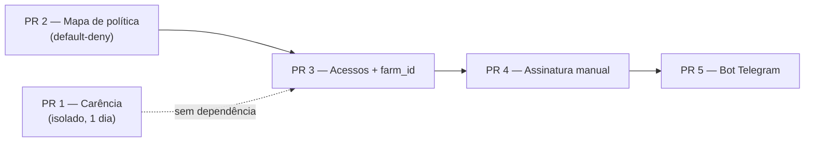

# SGG+ — Revisão do plano e plano de execução

> Revisão do plano "Sistema_Gado+ (SGG+)" contra o código real em `main` /
> `feat/redesign-instrumento`, e o plano de execução correspondente, fatiado em 5 PRs.
>
> Status: proposta. Nada deste documento foi implementado ainda.

---

## 1. Veredito

O plano original está correto no que é **banco de dados**: o dialeto é PostgreSQL válido, a
política só-aditiva (`#78`) passa em `tests/test_migrations.py`, e `vw_animais_em_carencia`
está certa como *view* normal (depende de `CURRENT_DATE`, não pode ser matview).

O que não se sustenta é a **camada de identidade**. O truque de tenancy proposto
(`User.id = owner_user_id or id`) parte da premissa de que `current_user.id` significa
"fazenda" em todo lugar do app — e essa premissa é falsa exatamente nas rotas onde o erro é
destrutivo. Além disso, o plano protege `/financeiro` mas deixa `api_bp` aberto, onde moram as
rotas que devolvem dinheiro.

Também há um problema de escopo: quatro fases nesse tamanho não são uma sprint. A fatia da
Fase 2 (carência) é demonstrável em um dia e **não depende de nada** do resto.

---

## 2. Achados bloqueantes

| # | Achado | Evidência no código | Consequência |
|---|---|---|---|
| 1 | O truque de tenancy quebra em rotas de conta | `routes/auth.py:276-281` — `confirmacao != current_user.username` passa com o username do vaqueiro, e `delete_user_and_data(current_user.id)` recebe o id do **dono** | Vaqueiro apaga a conta e todos os dados da fazenda |
| 2 | `consultor` não cabe em uma coluna | `owner_user_id integer` é 1:1 | Um consultor atende N fazendas — é o próprio tier `consultor` do plano |
| 3 | `api_bp` sem guarda de papel | `routes/api.py:343` `/api/financeiro/custos`, `:360` `/api/v1/export/financeiro.csv`, `:221` `/api/dashboard-summary`, `:254` PDF | Bloquear `/financeiro` não impede o vaqueiro de baixar o CSV financeiro |
| 4 | `bot_vinculos` não representa pareamento pendente | `chat_id NOT NULL` + `account_user_id UNIQUE` | Impossível inserir a linha do código antes de existir `chat_id`; e impede Telegram + WhatsApp na mesma conta |
| 5 | Webhooks sem CSRF exempt e sem assinatura | `CSRFProtect(app)` global em `app.py:47` | Todo POST do webhook responde 400; e webhook sem verificação é endpoint de escrita aberto |
| 6 | Billing sem razão e sem idempotência | — | Provider reenvia evento; não há histórico de pagamento, só estado atual |
| 7 | `trial_ends_at DEFAULT (now() + interval '14 days')` | PG preenche linhas existentes no `ADD COLUMN` | Todas as contas atuais ganham um relógio de trial que vence junto |
| 8 | Nenhuma escrita registra autoria | Todo INSERT grava `user_id` do dono | "Quem pesou o 402?" não tem resposta; e o override de carência fica sem assinatura |

### Ajustes menores

- `protocolos_sanitarios.dias_carencia_padrao` é coluna morta: `registrar_aplicacao`
  (`repositories/sanitario_repository.py:40`) só avança `proxima_aplicacao`, **nunca** insere em
  `medicacoes`. Protocolo e medicação são desconectados hoje.
- `usuarios.username` é UNIQUE global — a segunda fazenda a convidar um "joao" colide.
- Escrita do bot indo `NLP → repository` ignora `routes/validators.py`: duas validações diferentes.
- Bot responde do `*_live`, a web lê matview com refresh de 5 min: o vaqueiro não vê a própria pesagem.
- `limite_cabecas` sem ponto de aplicação definido.
- `session['plano_status']` fica velho: quem paga continua bloqueado até relogar.
- `contador` read-only tem que barrar por método (`not in SAFE_METHODS`), não só `POST`.
- Revogar sub-conta (`ativo = 0`) não derruba o cookie — `load_user` precisa checar.
- Fase 4 remove o cadastro gratuito, que é justamente o funil que o `trial_ends_at` serve.

---

## 3. Plano de execução



### PR 1 — Carência sanitária (`migrations/0005.carencia.sql`)

Não toca em auth. Fecha a Fase 2 do plano original sozinho.

```sql
ALTER TABLE medicacoes
    ADD COLUMN IF NOT EXISTS dias_carencia integer NOT NULL DEFAULT 0
        CHECK (dias_carencia >= 0);

CREATE OR REPLACE VIEW vw_animais_em_carencia AS
SELECT a.user_id, a.id AS animal_id, a.brinco,
       m.id AS medicacao_id, m.nome_medicamento, m.data_aplicacao, m.dias_carencia,
       (m.data_aplicacao + m.dias_carencia)                  AS data_liberacao,
       ((m.data_aplicacao + m.dias_carencia) - CURRENT_DATE) AS dias_restantes
FROM medicacoes m
JOIN animais a ON a.id = m.animal_id
WHERE m.deleted_at IS NULL AND a.deleted_at IS NULL AND a.data_venda IS NULL
  AND m.dias_carencia > 0
  AND (m.data_aplicacao + m.dias_carencia) > CURRENT_DATE;

CREATE INDEX IF NOT EXISTS ix_med_carencia
    ON medicacoes (animal_id, data_aplicacao) WHERE dias_carencia > 0;

CREATE TABLE IF NOT EXISTS vendas_com_carencia (
    id             integer GENERATED BY DEFAULT AS IDENTITY PRIMARY KEY,
    animal_id      integer NOT NULL REFERENCES animais(id),
    medicacao_id   integer NOT NULL REFERENCES medicacoes(id),
    autorizado_por integer NOT NULL REFERENCES usuarios(id),
    data_liberacao date NOT NULL,
    created_at     timestamptz DEFAULT now()
);
```

**Fora:** `dias_carencia_padrao` em `protocolos_sanitarios`. Sem FK de `medicacoes` para protocolo,
o valor não tem caminho até a aplicação. O default entra nos dois INSERTs reais
(`repositories/animal_repository.py:649` e `:674`), pré-preenchido por um dicionário de produtos
comuns (`Ivermectina: 35`, etc.). Fazer `registrar_aplicacao` emitir linhas em `medicacoes` é
mudança de comportamento — vale a pena, mas em PR próprio.

**Aplicação:**

- `sanitario_repository.get_carencias_ativas(user_id, animal_ids=None)` — uma query na view, com
  `= ANY(%s)` quando vêm ids.
- Guarda em `vender` (`routes/operacional.py:270`) e `venda_lote` (`:298`), logo depois do bloco
  `errors` que já existe: 400 com os brincos bloqueados e a data de liberação.
- `confirmar_carencia=1` grava em `vendas_com_carencia`. Override sem registro não serve de nada —
  é a única evidência que existe se a carcaça for rejeitada.
- Dois cards novos em `ocorrencias` do `/inicio`: animais em carência e lotes sem pesagem há 45+ dias.

**Testes** (`tests/test_carencia_lock.py`): venda dentro da janela → 400; com override → 200 **e**
linha de auditoria; no dia seguinte a `data_liberacao` → 200; limite em `dias_restantes = 0`.

### PR 2 — Mapa de política com default-deny

Entra **antes** do RBAC. Com um papel só é inócuo em comportamento — e é por isso que é seguro
mergear. Depois dele, nenhuma rota nova escapa da pergunta.

`utils/permissions.py`:

```python
SAFE = {'GET', 'HEAD', 'OPTIONS'}

POLICY = {
    'financeiro.financeiro':     ('dono', 'contador'),
    'api.export_financeiro_csv': ('dono', 'contador'),
    'api.custos_por_ano':        ('dono', 'contador'),
    'api.dashboard_summary':     ('dono', 'contador'),
    'operacional.vender':        ('dono',),
    # ... 70 endpoints
}
PUBLICO = {'auth.login', 'auth.novo_usuario', 'static'}
```

Registrado como `app.before_request` que **nega por padrão**: endpoint desconhecido → 403 e log.
`contador` é barrado por `request.method not in SAFE`, não por `POST`.

O teste é o entregável de verdade:

```python
def test_todo_endpoint_tem_politica(app):
    faltando = [r.endpoint for r in app.url_map.iter_rules()
                if r.endpoint not in POLICY and r.endpoint not in PUBLICO]
    assert not faltando, f"endpoints sem política declarada: {faltando}"
```

São 70 endpoints para classificar à mão, uma vez. Depois disso fica impossível adicionar rota e
esquecer: a suíte fica vermelha.

### PR 3 — Tabela de acessos + `farm_id` explícito (`migrations/0006.acessos.sql`)

```sql
ALTER TABLE usuarios ADD COLUMN IF NOT EXISTS ativo smallint NOT NULL DEFAULT 1;

CREATE TABLE IF NOT EXISTS acessos_fazenda (
    id              integer GENERATED BY DEFAULT AS IDENTITY PRIMARY KEY,
    account_user_id integer NOT NULL REFERENCES usuarios(id) ON DELETE CASCADE,
    owner_user_id   integer NOT NULL REFERENCES usuarios(id) ON DELETE CASCADE,
    papel           varchar(20) NOT NULL
                    CHECK (papel IN ('vaqueiro','contador','consultor')),
    ativo           smallint NOT NULL DEFAULT 1,
    created_at      timestamptz DEFAULT now(),
    UNIQUE (account_user_id, owner_user_id)
);
CREATE INDEX IF NOT EXISTS ix_acessos_conta ON acessos_fazenda (account_user_id, ativo);

ALTER TABLE pesagens              ADD COLUMN IF NOT EXISTS registrado_por integer REFERENCES usuarios(id);
ALTER TABLE medicacoes            ADD COLUMN IF NOT EXISTS registrado_por integer REFERENCES usuarios(id);
ALTER TABLE custos_operacionais   ADD COLUMN IF NOT EXISTS registrado_por integer REFERENCES usuarios(id);
ALTER TABLE estoque_movimentacoes ADD COLUMN IF NOT EXISTS registrado_por integer REFERENCES usuarios(id);
```

`papel` **não** fica em `usuarios`: `dono` é simplesmente quem não tem linha ativa em
`acessos_fazenda`. Sem CHECK para brigar quando surgir um papel novo, e o consultor ganha N linhas
em vez de uma coluna impossível.

`models.py`:

```python
class User(UserMixin):
    def __init__(self, id, username, password_hash, email=None,
                 farm_id=None, papel='dono', ativo=1):
        self.id = id                      # sempre a linha real em usuarios
        self.farm_id = farm_id or id      # tenant: o que vai para os repositórios
        self.papel = papel
```

`get_id()` continua sendo o padrão do `UserMixin` — fica correto de graça, porque `self.id` volta a
ser verdade. O loader resolve a fazenda:

```sql
SELECT u.id, u.username, u.password_hash, u.email, u.ativo,
       COALESCE(a.owner_user_id, u.id) AS farm_id,
       COALESCE(a.papel, 'dono')       AS papel
FROM usuarios u
LEFT JOIN acessos_fazenda a
       ON a.account_user_id = u.id AND a.ativo = 1
WHERE u.id = %s AND u.ativo = 1
```

O `ativo = 1` no loader é a revogação: o cookie do vaqueiro demitido para de valer no request
seguinte, não no vencimento do cookie.

**A varredura.** Os 121 `current_user.id` estão todos em `routes/` (zero em `templates/`, zero em
`utils/`):

```bash
sed -i 's/current_user\.id/current_user.farm_id/g' routes/*.py
```

Depois reverter à mão os casos de identidade — `apagar_conta` (`routes/auth.py:276`) é o único em
`auth.py`, mais o que em `configuracoes.py` mexe na conta e não na fazenda. E travar com teste de
grep: `current_user.id` fora da allowlist é quase sempre bug de tenant.

**Consultor multi-fazenda:** o JOIN devolve N linhas. O MVP escolhe uma e guarda em
`session['farm_id']` — e `load_user` **obrigatoriamente** revalida esse valor contra
`acessos_fazenda` em todo request, senão editar o cookie vira acesso cruzado. O seletor de fazenda
na navbar vem depois; a revalidação não.

**Convites:** username de sistema (`<fazenda>.joao`) para não colidir no UNIQUE global, login por
email, e primeira senha pelo fluxo de `password_reset_tokens`, que já existe com código e expiração.

**Testes:** vaqueiro da fazenda A toma 403 em todo endpoint `('dono','contador')`; vaqueiro de A não
lê nada de B (estender `tests/test_tenant_isolation.py`, que já tem o helper `_make_user`); e o teste
que pegaria o bug — vaqueiro posta o próprio username em `/conta/apagar` e os dados do dono
continuam lá.

### PR 4 — Assinatura, manual primeiro (`migrations/0007.planos.sql`)

```sql
ALTER TABLE configuracoes
    ADD COLUMN IF NOT EXISTS plano_tier     varchar(20) NOT NULL DEFAULT 'trial',
    ADD COLUMN IF NOT EXISTS plano_status   varchar(20) NOT NULL DEFAULT 'ativo',
    ADD COLUMN IF NOT EXISTS trial_ends_at  timestamptz,
    ADD COLUMN IF NOT EXISTS limite_cabecas integer NOT NULL DEFAULT 250;

-- contas que já existem não entram em trial retroativo
UPDATE configuracoes
   SET plano_tier = 'porteira', trial_ends_at = NULL
 WHERE trial_ends_at IS NULL;

CREATE TABLE IF NOT EXISTS pagamentos (
    id                integer GENERATED BY DEFAULT AS IDENTITY PRIMARY KEY,
    user_id           integer NOT NULL REFERENCES usuarios(id),
    provider          varchar(20) NOT NULL,
    provider_event_id varchar(120) NOT NULL,
    valor             numeric(10,2),
    status            varchar(20) NOT NULL,
    payload           jsonb,
    created_at        timestamptz DEFAULT now(),
    UNIQUE (provider, provider_event_id)
);
```

`trial_ends_at` **sem** default: os 14 dias são setados explicitamente no `novo_usuario`
(`routes/auth.py:112`, que já insere a linha de `configuracoes` — toda conta tem uma). Default de
coluna teria carimbado a mesma data de vencimento em todas as contas existentes.

A trava lê por request, não da sessão:

```python
@app.before_request
def _carrega_plano():
    g.plano = configuracao_repository.get_plano(current_user.farm_id)
```

`limite_cabecas` ganha exatamente dois pontos de aplicação — insert de animal e import de CSV — e
nunca esconde animal existente; um teste para cada.

**Sem webhook neste PR.** Link de pagamento Asaas + tela de ativação manual converte os mesmos
clientes neste volume e tira o sandbox de um provider do caminho crítico da sprint. O webhook é o
PR 4b: `@csrf.exempt`, `asaas-access-token` comparado com `hmac.compare_digest`, INSERT em
`pagamentos` e o UNIQUE engolindo os reenvios.

### PR 5 — Bot, só Telegram, atrás de flag (`migrations/0008.bot.sql`)

```sql
CREATE TABLE IF NOT EXISTS bot_pareamentos (
    id              integer GENERATED BY DEFAULT AS IDENTITY PRIMARY KEY,
    account_user_id integer NOT NULL REFERENCES usuarios(id) ON DELETE CASCADE,
    codigo          char(6) NOT NULL,
    expires_at      timestamptz NOT NULL,
    used            smallint NOT NULL DEFAULT 0,
    created_at      timestamptz DEFAULT now()
);

CREATE TABLE IF NOT EXISTS bot_vinculos (
    id              integer GENERATED BY DEFAULT AS IDENTITY PRIMARY KEY,
    account_user_id integer NOT NULL REFERENCES usuarios(id) ON DELETE CASCADE,
    plataforma      varchar(20) NOT NULL CHECK (plataforma IN ('telegram','whatsapp')),
    chat_id         varchar(100) NOT NULL,
    ativo           smallint NOT NULL DEFAULT 1,
    created_at      timestamptz DEFAULT now(),
    UNIQUE (plataforma, chat_id),
    UNIQUE (account_user_id, plataforma)
);
```

Duas tabelas porque o código de pareamento precisa existir **antes** de haver `chat_id` — mesma
forma de `password_reset_tokens`, que já é padrão provado neste código.

**A ordem que importa: extrair a camada de serviço antes de escrever o bot.** Tirar o corpo do POST
de pesagem de `routes/operacional.py` para
`services/pesagem.py::registrar(farm_id, brinco, peso, data, registrado_por)`, fazer a rota
existente chamar isso, confirmar a suíte verde, **depois** apontar o bot para lá. Bot chamando
repository direto cria um segundo conjunto de regras de validação — e a que fica mais fraca é
justamente a que guarda o dado digitado com uma mão no curral.

Webhook: `@csrf.exempt`, `secret_token` do Telegram com `compare_digest`, `limiter` por `chat_id`, e
fazenda resolvida por `bot_vinculos → acessos_fazenda`, para o bot herdar a mesma política da web.
A intenção `DESPESA` checa `papel == 'dono'` pelo mesmo motivo que `/financeiro` checa. O parser é
função pura e ganha teste de tabela — sem banco, sem app context, ~30 frases, incluindo as que devem
falhar fechado.

**WhatsApp fica fora:** Cloud API exige verificação de negócio, janela de 24h e template aprovado
para o digest de segunda. Entra quando alguém pagar por isso.

---

## 4. Fora dos PRs

**Refresh de matviews** é a parede real de escala e pertence à `#117`, não aqui: `refresh_matviews`
faz `REFRESH CONCURRENTLY` das três matviews, de todos os tenants, a cada 5 minutos, para sempre.
Correção mais barata: uma linha `matview_estado(nome, ultimo_refresh)` e pular o refresh quando nada
foi escrito desde então. Junto com ler `*_live` nas telas de animal individual, o que também elimina
o ticket "o bot confirmou minha pesagem mas o site não mostra".

**PDF de diagnóstico** deixa de ser feature e vira `scripts/diagnostico.py`, que recebe um caminho de
CSV e escreve um PDF. Sem tenant, sem dado de prospect em produção, e sem pegar carona num caminho
do Playwright cujo teste de limpeza (`test_pdf_cleanup`) ainda está vermelho no Windows.

---

## 5. O que muda em relação ao plano original

| Plano original | O que fica |
|---|---|
| `User.id = owner_user_id or id` | `self.id` = linha real; `current_user.farm_id` explícito; varredura mecânica de 121 chamadas |
| `usuarios.papel` + `owner_user_id` | Tabela `acessos_fazenda` (resolve consultor N:N) |
| `@role_required` por rota | `POLICY` central + `before_request` default-deny + teste de cobertura sobre `url_map` |
| `protocolos_sanitarios.dias_carencia_padrao` | Cortado (coluna morta); default nos INSERTs de `medicacoes` |
| `bot_vinculos` com `codigo_pareamento` | `bot_pareamentos` separada + `UNIQUE (account_user_id, plataforma)` |
| Webhook de billing na sprint | Link de pagamento + ativação manual; webhook no PR 4b com tabela `pagamentos` |
| `trial_ends_at` com DEFAULT | Sem default + DML de grandfathering |
| Telegram **e** WhatsApp | Telegram só |
| Landing troca cadastro grátis por preços | Mantém o trial; preços acima da dobra |
| PDF de diagnóstico no `api_bp` | `scripts/diagnostico.py` |
| 4 fases, 1 sprint | 5 PRs, 2–3 semanas; PR 1 demonstrável em 1 dia |

---

## 6. Portões de qualidade

Cada PR fecha com, na ordem:

```bash
pytest tests/test_migrations.py
pytest tests/test_tenant_isolation.py tests/test_rbac_and_billing.py
pytest tests/
```

E, do PR 2 em diante, `test_todo_endpoint_tem_politica` passa a ser o portão que não deixa a
superfície de rotas crescer sem política declarada.
